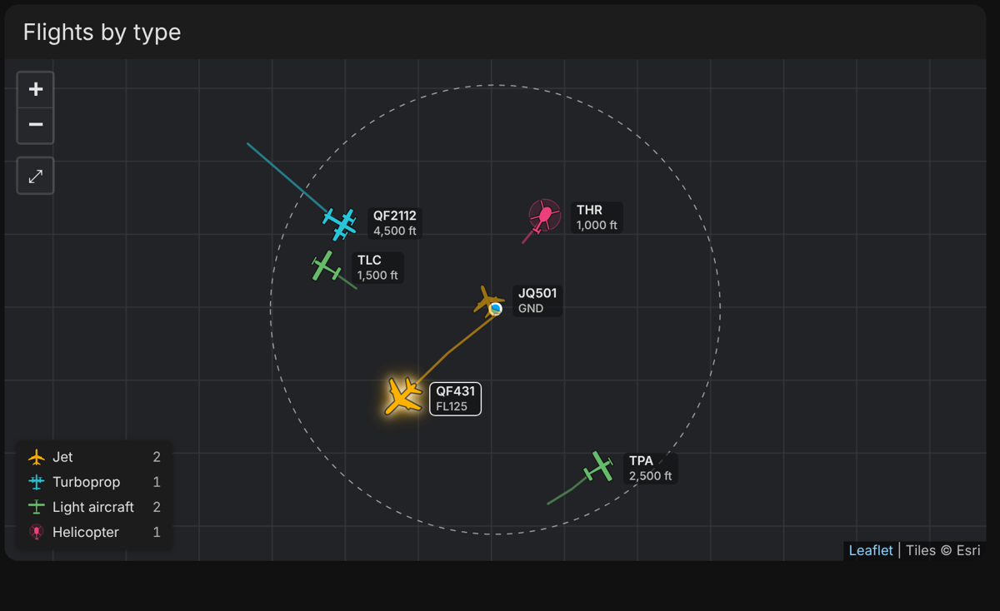
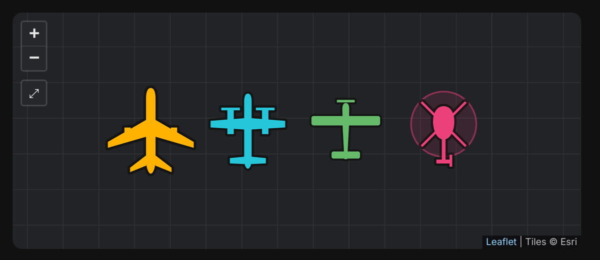
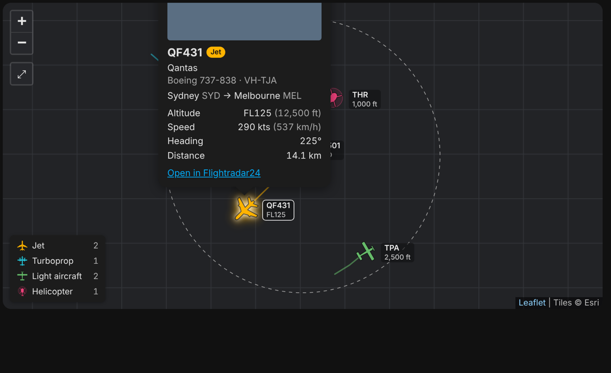

# Aircraft Type Map Card

A Home Assistant dashboard card that maps the aircraft reported by the
[FlightRadar24 integration](https://github.com/AlexandrErohin/home-assistant-flightradar24)
and draws each one by type: **jet**, **turboprop**, **light aircraft** or **helicopter**.



<sub>Rendered with the synthetic test data in `test/fixture.json`; on a real dashboard the map tiles show roads, towns and terrain.</sub>

## Features

- Top-down silhouette per aircraft type, each in its own colour, rotated to the aircraft's heading
- Callsign and altitude label on every aircraft (flight levels above 10,000 ft)
- Flight trails in the type colour
- Legend with a live count per type; tap a type to hide or show it
- Tap an aircraft for its photo, operator, model, registration, route, altitude, speed and a link to Flightradar24
- Optional highlight for one aircraft, driven by any entity with an `fr24_id` attribute, a fixed id, or a tap
- Tapping an aircraft fires an `aircraft-selected` event, so a dashboard or host card can follow the selection
- Aircraft glide along their heading between integration polls instead of jumping
- Dashed circle for the integration's tracking radius; the map fits it automatically until you pan or zoom
- Follows Home Assistant's light and dark mode, or pick a fixed style

| Icons | Popup |
| --- | --- |
|  |  |

## Requirements

- The [FlightRadar24 integration](https://github.com/AlexandrErohin/home-assistant-flightradar24). The card reads the
  `flights` and `bounds` attributes of its **Current in area** sensor (usually `sensor.flightradar24_current_in_area`).
- The browser showing the dashboard needs internet access. The card loads [Leaflet](https://leafletjs.com) 1.9.4 from
  jsDelivr (pinned and integrity-checked) and map tiles from Esri, or OpenStreetMap if you choose `map_style: osm`.

## Installation

### HACS

1. In HACS, open the ⋮ menu → **Custom repositories**.
2. Add `https://github.com/lordy16/aircraft-type-map-card` with type **Dashboard**.
3. Search for **Aircraft Type Map Card**, download it, then reload the browser.

### Manual

1. Copy `dist/aircraft-type-map-card.js` to `/config/www/`.
2. Settings → Dashboards → ⋮ → Resources → **Add resource**: URL `/local/aircraft-type-map-card.js?v=0.1.1`,
   type **JavaScript module**. Bump the `?v=` number after every update.

## Configuration

```yaml
type: custom:aircraft-type-map-card
entity: sensor.flightradar24_current_in_area
```

| Option | Default | Description |
| --- | --- | --- |
| `entity` | required | The FlightRadar24 **Current in area** sensor |
| `title` | none | Card header |
| `height` | `420` | Map height in pixels |
| `map_style` | `auto` | `auto` (follows HA dark mode), `dark`, `light`, `satellite` or `osm` |
| `tile_url` | none | Custom XYZ tile template; overrides `map_style` |
| `tile_attribution` | none | Attribution text for a custom `tile_url` |
| `show_tracks` | `true` | Draw each aircraft's trail |
| `show_labels` | `true` | Callsign and altitude next to each aircraft |
| `show_legend` | `true` | Type legend with counts and show/hide toggles |
| `show_home` | `true` | Marker at the home location (HA home unless `latitude`/`longitude` are set) |
| `show_radius` | `true` | Dashed circle for the integration's tracking radius |
| `latitude` / `longitude` | HA home | Centre used for the home marker and radius circle |
| `dead_reckoning` | `true` | Move aircraft along their heading between sensor updates |
| `icon_scale` | `1` | Multiplies every icon size |
| `highlight_entity` | none | Entity whose `fr24_id` attribute names an aircraft to highlight |
| `highlight_id` | none | FR24 id of an aircraft to highlight; takes priority over `highlight_entity` |
| `popups` | `true` | Open the details popup when an aircraft is tapped; `false` only selects it |
| `colors` | see below | Override any type colour, e.g. `{ jet: '#ff9800' }` |
| `type_overrides` | none | Force a class for an ICAO type code, e.g. `{ C208: light }` |

Default colours: jet `#ffb300`, turboprop `#26c6da`, light aircraft `#66bb6a`, helicopter `#ec407a`.

### Full example

```yaml
type: custom:aircraft-type-map-card
entity: sensor.flightradar24_current_in_area
title: Flights overhead
height: 540
map_style: auto
highlight_entity: sensor.featured_flight
type_overrides:
  C208: light   # show Cessna Caravans as light aircraft instead of turboprops
colors:
  helicopter: '#ff5252'
```

## How aircraft are classified

FlightRadar24's own `aircraft_category` is unreliable: it often reports helicopters as "Airplane". The card works from
the ICAO type code (`aircraft_code`) and the model name instead, in this order:

1. `type_overrides`, if the type code is listed
2. **Helicopter**: known helicopter type codes (R44, EC35, B06, H269, …) or a helicopter maker or model in the name
3. **Turboprop**: known turboprop codes (DH8D, SF34, AT72, B190, C208, PC12, …) or names like "Dash 8", "King Air", "Caravan"
4. **Jet**: airliner and business-jet code patterns (A3xx, B7xx, E1xx, CRJx, Citations, Learjets, …) or matching names
5. Anything else: **jet** if it is doing 260 kts or more or is at 22,000 ft or above, otherwise **light aircraft**

If something shows up as the wrong type, add its code to `type_overrides`, or open an issue with the code and model
so the built-in lists can be fixed.

## Selecting aircraft from another card

Tapping an aircraft highlights it and fires an `aircraft-selected` event that bubbles out of the card, with
`event.detail = { id, flight }` (`flight` is the integration's record for that aircraft). A card that hosts this one can
also drive the highlight:

```js
map.select('4261ceed'); // highlight this FR24 id
map.select(null);       // back to highlight_id / highlight_entity
```

A selection that leaves the tracking area falls back to `highlight_id` / `highlight_entity` on its own. Set
`popups: false` when the host shows the details itself.

## Notes

- **Auto-fit**: the map fits the tracking area when it loads, when the card resizes and when the integration's radius
  changes. Once you pan or zoom, it stays where you left it until you press the ⤢ button, or until the card is shown again
  after being removed from the page (for example a pop-up or full-screen view closing and reopening).
- **Reverse proxies**: if a proxy in front of Home Assistant adds a Content-Security-Policy header, allow
  `cdn.jsdelivr.net` for scripts and styles and the tile hosts for images, or the map will not load.
- Map tiles are © Esri or © OpenStreetMap contributors, as credited on the map.

## Development

```bash
npm install
npx playwright-core install chromium   # or set CHROMIUM_PATH to an existing Chromium
npm test
```

The test run renders the card in headless Chromium against `test/fixture.json` with all network access stubbed out.
It checks classification, the popup, legend toggles, auto-fit and selection behaviour, and writes screenshots to `test/out/`.

## Credits

- [AlexandrErohin/home-assistant-flightradar24](https://github.com/AlexandrErohin/home-assistant-flightradar24) for the flight data
- [Leaflet](https://leafletjs.com) for map rendering
- Esri and OpenStreetMap contributors for map tiles

## License

[MIT](LICENSE)
